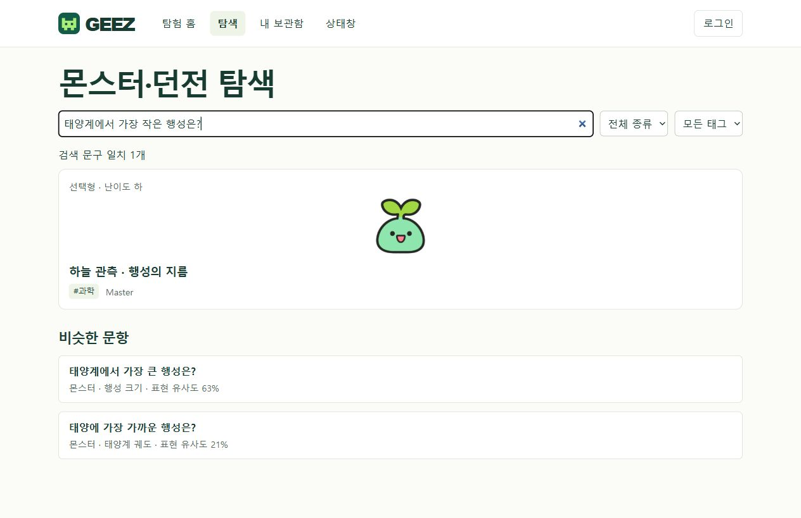
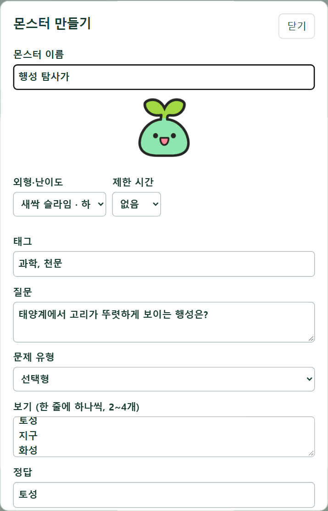
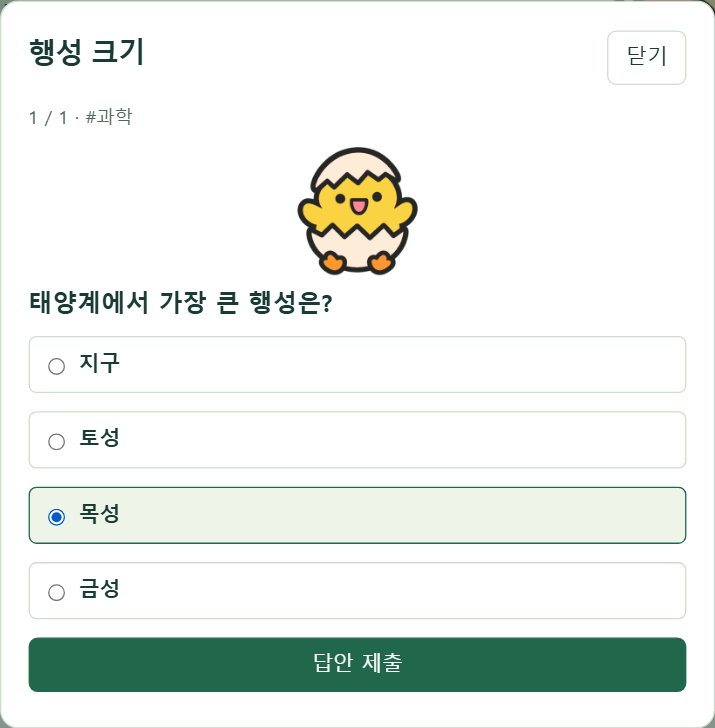
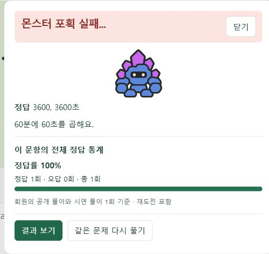
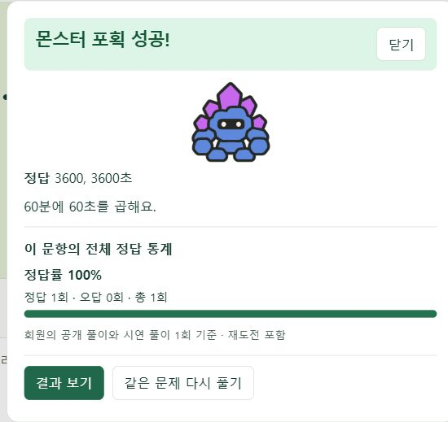
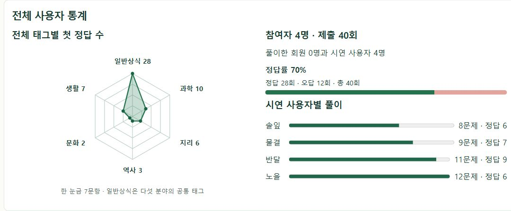

# GEEZ · 몬스터 탐험대

퀴즈 한 문제를 몬스터 한 마리로 표현한 학습 웹앱이다. 누구나 다른 사람이 낸 문제를 풀어 몬스터를 포획하고, 자신이 아는 내용도 문제로 만들어 나눌 수 있다.

단국대학교 소프트웨어학과 졸업작품 · 32231798 박유찬
Game-Education for EZ way

[웹앱](https://geez-quest.geez-monster-quest.workers.dev/) · [시연 영상](https://app.notion.com/p/Game-Education-for-EZ-41aefd12f0f080e69868e26b9e5a2c0d?source=copy_link) · [결과보고서 PDF](output/GEEZ_Project_Report.pdf) · [포스터 PDF](output/GEEZ_Poster.pdf)

## 기획 배경

어려운 문제를 스스로 풀어냈을 때의 성취감은 다음 문제에 도전할 힘이 된다. 유튜브 쇼츠처럼 짧고 자극적인 콘텐츠가 익숙한 일상에서도, 다양한 분야의 상식 문제를 풀고 새로 알게 된 내용을 다른 사람과 나누는 즐거움을 느낄 수 있도록 GEEZ를 기획했다.

## 프로젝트 목표

문제 하나를 몬스터 한 마리로 표현해, 정답을 맞히고 몬스터를 포획하는 경험이 다음 문제에 도전할 의욕으로 이어지도록 하는 것이 목표다. 누구나 다른 사람이 낸 문제를 풀며 상식을 넓히고, 자신이 더 깊이 알아본 주제는 직접 질문과 해설로 만들어 나눌 수 있다.

## 기대 효과

반지성주의가 우려되는 사회에서, 낯선 상식을 접했을 때 ‘왜 그럴까?’ 하고 스스로 답을 찾아보는 즐거움을 전하고자 한다. 어려운 문제를 풀어낸 성취감과 새로 배운 것을 다른 사람과 나누는 기쁨이 다음 질문을 찾아보는 힘이 되기를 기대한다.

## 화면별 설명

### 몬스터·던전 탐색

‘태양계에서 가장 작은 행성은?’을 검색하면 일치하는 몬스터인 ‘하늘 관측 · 행성의 지름’이 먼저 나온다. 그 아래에는 ‘태양계에서 가장 큰 행성은?’처럼 표현이 비슷한 다른 문항이 표시된다.



### 문제 제작과 풀이

| 몬스터 만들기 | 문제 풀기 |
| --- | --- |
|  |  |
| 내 보관함에서 몬스터의 외형과 난이도를 고르고, 다른 사람에게 내고 싶은 질문과 정답을 입력한다. | 탐색에서 몬스터를 열고 도전을 시작한다. 선택형은 보기를 고르고 단답형은 답을 직접 입력해 제출한다. |

### 포획 결과

1시간이 몇 초인지 묻는 문제의 결과다. 답을 제출하면 포획 여부와 함께 정답·해설을 확인하고, 같은 문제에 다시 도전할 수 있다.

| 오답을 제출했을 때 | 정답을 제출했을 때 |
| --- | --- |
|  |  |

### 상태창과 학습 통계

상태창의 ‘전체 사용자 통계’에서 태그별 첫 정답 수와 전체 정답률을 확인할 수 있다. 아래는 시연 사용자 4명이 40회 도전해 28회 정답을 기록한 예시다.



## 학습 흐름

| 단계 | 동작 |
| --- | --- |
| 제작 | 몬스터의 질문·보기·허용 답안·해설·태그를 정한다. 출제 중 표현이 비슷한 공개 문항을 확인할 수 있다. |
| 공유 | 보관함의 작품을 링크로 전달하거나 로그인 후 공용 목록에 등록한다. 같은 태그의 몬스터 1~20마리를 선택한 순서로 던전에 배치한다. |
| 탐색 | 이름·태그·문제 내용에서 입력한 문구를 찾는다. 두 글자 이상 입력하면 같은 필터 범위에서 표현이 비슷한 다른 문항도 최대 세 개 보여 준다. |
| 풀이 | 선택형·단답형 답안을 채점한다. 포획 성공은 초록색, 실패와 시간 초과는 빨간색 제목으로 표시한다. 처음 맞힌 문항에서만 난이도에 따라 20·35·50 XP를 받는다. |
| 복습 | 상태창에서 첫 정답 수와 누적 포획 수를 비교한다. 한 태그에서 서로 다른 세 문제 이상을 풀고 첫 오답이 있으면 이전 오답과 미도전 문항으로 최대 다섯 문제의 복습 던전을 편성한다. |

### 기본 문제은행

기본 문제은행에는 일반상식 500문항이 있다. 각 문항에는 일반상식과 해당 분야의 태그가 붙는다. 다섯 기본 던전은 분야별로 문항을 묶은 것이다.

| 과학 | 지리 | 역사 | 문화 | 생활 | 합계 |
| ---: | ---: | ---: | ---: | ---: | ---: |
| 104 | 101 | 97 | 99 | 99 | **500** |

### 통계 읽기

| 화면 | 표시하는 값 | 집계 기준 |
| --- | --- | --- |
| 내 상태창 | 육각형 차트의 태그별 첫 정답 수, 첫 도전 정답률, 포획 수, 경험치 | 같은 문항을 다시 풀어도 첫 제출 결과를 보존한다. 처음 틀린 뒤 맞히면 포획 수가 증가한다. |
| 전체 사용자 | 참여 인원, 정답·오답 횟수, 정답률, 태그별 첫 정답 수 | 회원의 완료된 공개 풀이에 시연 사용자 네 명의 기록을 합한다. 게스트와 개인 보관함 연습은 개인 기록에만 남는다. |
| 공개 문항 | 상세·풀이·결과 화면의 전체 정답률과 정답·오답 횟수 | 완료된 제출을 기준으로 재도전도 포함한다. 같은 답안 요청을 다시 보내도 한 번만 센다. 제출이 0회면 기록 없음으로 표시한다. |

## 시스템 구성

탐색 화면을 열면 GEEZ 서버가 데이터베이스(Cloudflare D1)에서 문제와 던전 목록을 읽어 보여 준다. 로그인한 사용자가 공개 문제의 답을 제출하면 서버가 채점하고 풀이 결과를 저장한다. 비슷한 문항을 찾을 때는 Python으로 작성한 검색 서비스에 질문을 보낸다.

내 컴퓨터에서 실행할 때도 문제를 조회하고 채점하는 코드는 같다. 이때는 Node.js가 요청을 처리하고 SQLite가 기록을 저장한다. 검색기는 연속 두 글자·세 글자의 TF-IDF 벡터를 비교한다. 코사인 유사도 0.18 이상의 문항 가운데 상위 세 개를 반환한다. 기본 목록과 최근 공개 작품 100개에서 중복 질문을 제거한 뒤 최대 1,000개 후보를 비교한다.

| 경로 | 역할 |
| --- | --- |
| [0001_geez.sql](source/db/migrations/0001_geez.sql) · [0002_question_bank.sql](source/db/migrations/0002_question_bank.sql) | 회원·세션·공개 작품·풀이 테이블을 만들고, 기본 문항 500개·던전 5개·시연 풀이 40회를 DB에 넣는다. |
| [db/catalog.mjs](source/db/catalog.mjs) | 탐색에는 전체 기본 목록을 반환한다. 개별 도전과 문항 통계에는 공개 ID와 던전 내 순번으로 해당 문항을 조회한다. |
| [db/local.mjs](source/db/local.mjs) | 로컬 SQLite에 공통 SQL을 순서대로 적용하고 기존 로컬 회원·작품·풀이 기록을 이전한다. |
| [rules.js](source/rules.js) | 브라우저와 서버에서 같은 규칙으로 작품을 검증하고 답을 채점한다. 개인의 첫 풀이 기록으로 태그 통계와 복습 던전을 만든다. |
| [app.js](source/app.js) · [workshop.js](source/workshop.js) · [charts.js](source/charts.js) | `app.js`는 탐색과 풀이·결과 화면을, `workshop.js`는 문제 제작·보관·공유를, `charts.js`는 육각형 차트와 전체·문항별 정답 통계를 담당한다. |
| [api.mjs](source/api.mjs) · [community.mjs](source/community.mjs) | `api.mjs`는 로그인을 확인하고, 작품을 공개하고, 제출한 답을 채점한다. `community.mjs`는 풀이 기록을 모아 사용자별 풀이 횟수와 문항별 정답률을 계산한다. |
| [server.mjs](source/server.mjs) · [cloud/worker.mjs](source/cloud/worker.mjs) | 내 컴퓨터에서는 `server.mjs`가 브라우저 요청을 받아 SQLite를 사용한다. 배포한 사이트에서는 `worker.mjs`가 같은 요청을 받아 D1을 사용한다. |
| [search/](source/search/) | Python 유사도 계산 및 로컬·배포 호출 경로 |
| [output/](output/) | 졸업작품 결과보고서와 포스터 |

### 문제를 저장하고 읽는 과정

웹앱을 열면 브라우저가 기본 문제와 던전 목록을 요청하고(`GET /api/catalog`), 서버가 DB에서 목록을 읽어 돌려준다. `geez_questions`에는 질문·보기·허용 답안·해설을 저장한다. `geez_dungeon_items`에는 각 던전에서 사용할 문항 번호와 순서만 저장한다. 같은 문항을 단독으로 열거나 던전에서 풀어도 같은 내용을 읽는다.

회원이 공용 목록에 등록한 작품은 `geez_packs`에서 별도로 조회한다. 개인 보관함의 초안과 게스트의 풀이 이력은 해당 브라우저의 `localStorage`에 저장한다. Git에는 새 환경에서 문제은행을 재현할 SQL을 포함한다.

## 배포

```sh
npm ci
npm run cloud:check
```

`cloud:check`는 문제 조회와 채점을 맡는 서버와 유사 문항을 찾는 Python 검색 서비스가 각각 빌드되는지 확인한다.

Cloudflare에 배포할 때는 [서버 설정](wrangler.jsonc)에서 사용할 D1 데이터베이스를 지정하고, [검색 서비스 설정](source/search/wrangler.jsonc)에서 정한 이름을 서버의 검색 서비스 연결 이름과 맞춘다. `db:remote`는 운영 D1에 아직 적용하지 않은 SQL만 실행한다. DB를 준비한 뒤 서버와 검색 서비스를 배포한다.

```sh
npm run cloud:login
npm run db:remote
npm run cloud:deploy
```
