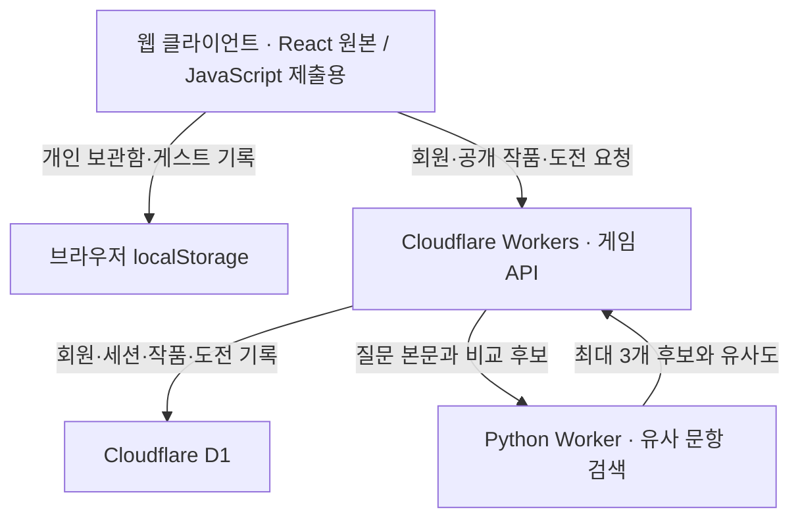

# GEEZ · 몬스터 탐험대

**퀴즈를 몬스터로 만들고, 스터디원과 던전을 공유하며, 태그별 기록을 보고 다시 공부하는 학습 웹앱**

소프트웨어학과 졸업작품 · 32231798 박유찬  
Game-Education for EZ way

[시연 영상](https://app.notion.com/p/Game-Education-for-EZ-41aefd12f0f080e69868e26b9e5a2c0d?source=copy_link) · [포스터 PDF](output/GEEZ_Poster.pdf) · [결과보고서 PDF](output/GEEZ_Project_Report.pdf) · [소스 코드](source/)

## 기획 배경

어려운 문제를 스스로 풀어냈을 때의 성취감은 다음 문제에 도전할 힘이 된다. 유튜브 쇼츠처럼 짧고 자극적인 콘텐츠가 익숙한 일상에서도, 내가 아는 것을 문제로 만들어 건네고 다른 사람이 그 답을 찾아가는 과정을 보며 지식을 나누는 즐거움을 느낄 수 있도록 GEEZ를 기획했다.

## 프로젝트 목표

문제 하나를 몬스터 한 마리로 표현해, 정답을 맞힐 때마다 포획의 성취감을 느끼게 하는 것이 목표다. 학습자는 서로 다른 관심사에서 나온 문제를 주고받으며 지식의 폭을 넓힐 수 있다. 더 깊이 공부하고 싶은 주제는 직접 질문과 해설을 만들고, 관련 문제를 하나의 던전으로 묶어 함께 풀 수 있다.

## 주요 기능

| 기능 | 사용자가 할 수 있는 일 |
| --- | --- |
| 몬스터 제작 | 선택형·단답형 질문에 정답, 해설, 태그, 외형과 제한 시간을 정한다. 질문을 작성하면서 표현이 비슷한 공개 문항을 확인한다. |
| 던전 편성과 공유 | 공통 태그를 가진 몬스터를 1~20마리 골라 등장 순서를 정한다. 개인 보관함의 작품은 JSON 파일로 주고받거나 공용 목록에 등록한다. |
| 탐험과 포획 | 문제를 처음 맞히면 몬스터를 포획하고 난이도에 따라 20·35·50 XP를 얻는다. |
| 태그별 상태창 | 분야마다 처음 맞힌 문제 수, 도전한 문제 수, 포획 수를 함께 본다. 재도전에서 맞혀도 첫 시도 결과는 보존된다. |
| 맞춤 복습 던전 | 기록이 쌓인 태그에서 이전 오답을 먼저 고르고 같은 태그의 미도전 문제로 채워 최대 5문항을 제시한다. |

## 시스템 아키텍처



React는 원 프로젝트의 웹 클라이언트를 구성한다. 이 저장소의 제출용 클라이언트는 `source/index.html`과 JavaScript로 탐색·제작·풀이 화면을 제공한다. 위 그림은 제출용 게임 API와 저장소, 검색 서비스의 연결을 나타낸다.

| 구성 | 기술 | 역할 |
| --- | --- | --- |
| 웹 화면 | React(원 프로젝트), HTML·CSS·JavaScript(제출용) | 질문 입력, 보기 선택, 던전 편성, 상태창 표시 |
| 게임 API | JavaScript · Cloudflare Workers | 회원 세션 확인, 공개 작품 등록, 도전 시작·채점, 검색 요청 전달 |
| 공용 저장소 | Cloudflare D1 · SQL | 회원·세션·공개 작품·풀이 기록 저장 |
| 유사 문항 검색 | Python Workers · Python 표준 라이브러리 | 문자 2·3그램 TF-IDF 벡터와 코사인 유사도로 공개 질문 비교 |
| 개인 보관 / 로컬 서버 | localStorage / Node.js · SQLite | 개인 작품·게스트 기록 보관 / 로컬 회원 API 제공 |

## 핵심 구현

### 첫 도전 정답과 포획을 각각 집계

문제마다 첫 제출의 정오와 포획 여부를 각각 기록한다. 다섯 분야에서 두 문제씩 푼 시연에서 지리와 문화는 모두 첫 도전 정답률이 50%였다. 지리는 재도전으로 두 문제 모두를 포획했고, 문화에는 미포획 문제가 하나 남았다.


### 풀이 기록으로 복습 던전 편성

서로 다른 문제를 세 개 이상 풀고 첫 오답이 있는 태그에서 후보를 찾는다. 세부 분야가 조건을 충족하면 첫 정답률이 가장 낮은 분야를 먼저 사용한다. 각 분야의 표본이 적을 때는 공통 태그인 일반상식을 사용할 수 있다. 첫 오답 중 아직 포획하지 못한 문제를 우선하고, 남은 자리는 미도전 문제로 채운다.

### 출제 중 비슷한 공개 문항 확인

게임 API가 작성 중인 질문과 공개 질문 후보를 Python Worker에 보낸다. Python은 공백·기호를 정리한 뒤 연속한 두 글자와 세 글자로 질문을 분해하고, 드문 표현에 더 큰 가중치를 준다. 코사인 유사도 0.18 이상인 후보를 최대 세 개 돌려준다. 출제자는 결과를 보고 기존 질문을 활용할지, 새 질문을 저장할지 결정한다.

## 소스 구성

| 경로 | 내용 |
| --- | --- |
| [source/app.js](source/app.js) · [source/workshop.js](source/workshop.js) | 탐험, 상태창, 개인 보관함, 제작·공유 화면 |
| [source/rules.js](source/rules.js) · [source/questions.js](source/questions.js) | 정답 판정, 태그 통계, 복습 던전 편성, 문항 데이터 |
| [source/api.mjs](source/api.mjs) | 클라우드·로컬 서버가 공유하는 회원·작품·도전 API |
| [source/cloud/](source/cloud/) · [wrangler.jsonc](wrangler.jsonc) | 게임 Worker, D1 스키마, 정적 자산·서비스 연결 설정 |
| [source/search/](source/search/) | Python 검색 Worker와 유사도 계산 |
| [source/server.mjs](source/server.mjs) | Node.js·SQLite 로컬 서버 |
| [tests/](tests/) · [output/](output/) | 기능 테스트 · 졸업작품 제출 자료 |

## 실행

### 내 PC에서 실행

Node.js 22.13 이상을 설치한다. 유사 문항 검색을 사용하려면 Python 3.12 이상도 준비한다. `GraduationGit` 폴더에서 PowerShell을 열고 실행한다.

```powershell
npm.cmd start
```

브라우저에서 [탐험 홈](http://127.0.0.1:3000)을 연다. 로컬 서버는 회원과 풀이 기록을 `data/geez.sqlite`에 저장한다. Python 실행 파일을 직접 지정하려면 서버를 시작하기 전에 `$env:GEEZ_PYTHON`에 경로를 설정한다.

### 기능 테스트와 배포 준비

```powershell
npm.cmd ci
npm.cmd test
npm.cmd run cloud:check
```

`cloud:check`는 Python 검색 Worker와 게임 Worker의 배포 파일을 생성하고 D1·검색 서비스 연결 설정을 확인한다.

### Cloudflare에 공개 배포

D1을 만든 계정으로 로그인한 후 `db:list`에서 대상 DB의 ID가 [wrangler.jsonc](wrangler.jsonc)의 `database_id`와 일치하는지 확인한다.

```powershell
npm.cmd run cloud:login
npm.cmd run db:list
npm.cmd run db:remote
npm.cmd run cloud:deploy
```

`db:remote`는 대상 D1에 회원·세션·공개 작품·풀이 기록 테이블을 생성한다. `cloud:deploy`는 내부 검색 Worker를 먼저 올리고 이어서 게임 Worker를 배포한다. 마지막에 출력된 게임 Worker 주소로 접속한다.
